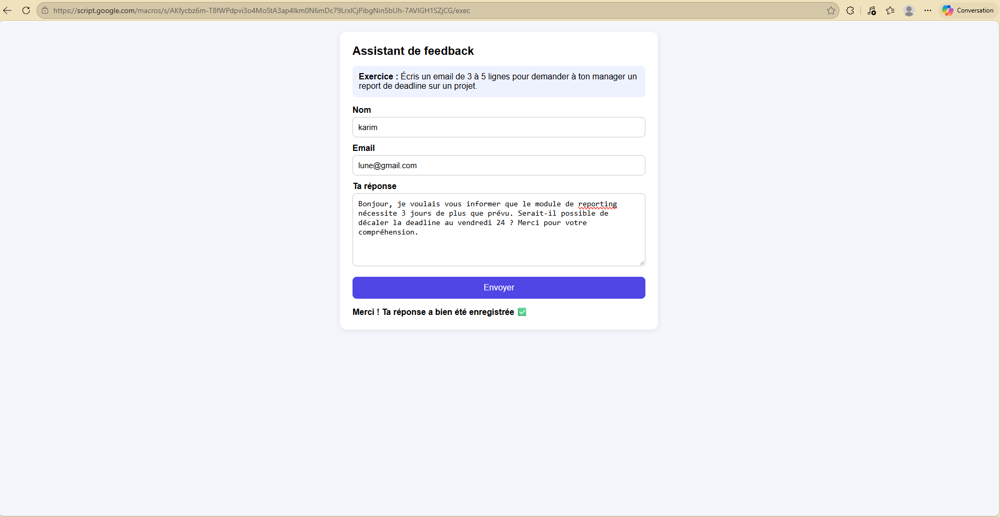
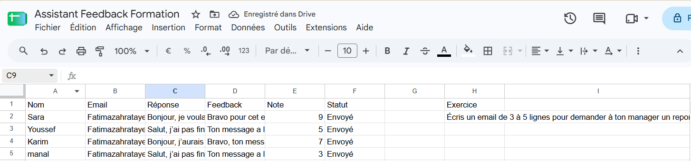
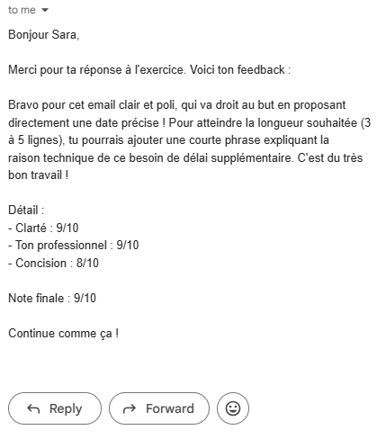

# Assistant de feedback pour formation

Mini-application d'automatisation pour le **Learning & Development** : les participants répondent à un exercice via une page web, **Gemini** génère un feedback bienveillant et une note, le résultat est écrit dans **Google Sheets** et envoyé par **Gmail**.

Le tout tourne avec **Google Apps Script**, sans serveur à gérer.

## Ce que fait le projet

1. Le participant ouvre la **page web** (formulaire HTML/CSS/JS), lit la consigne et envoie sa réponse.
2. La réponse est enregistrée dans un **Google Sheet**.
3. Le script envoie chaque réponse à l'**API Gemini** (clé créée dans Google AI Studio).
4. Gemini évalue la réponse selon **3 critères** (clarté, ton professionnel, concision) et rédige un **feedback court en français**.
5. Le feedback, les notes et la note finale (moyenne arrondie) sont écrits dans le Sheet.
6. Un **mail récap** est envoyé au participant via Gmail.

## Stack

| Brique | Technologie |
|---|---|
| Interface | HTML / CSS / JavaScript (`HtmlService`) |
| Automatisation | Google Apps Script |
| IA | API Gemini (Google AI Studio), modèle `gemini-3.5-flash` |
| Données | Google Sheets |
| Notification | Gmail (`GmailApp`) |

## Aperçu

<!-- Remplace les chemins par tes captures (dossier screenshots/) -->
| Page web | Google Sheet | Mail reçu |
|---|---|---|
|  |  |  |

## Structure

```
├── Code.gs       # Logique : appel Gemini, écriture dans le Sheet, envoi des mails, page web
├── Index.html    # Formulaire affiché aux participants
└── README.md
```

## Structure du Google Sheet

Onglet nommé **`Réponses`** :

| A | B | C | D | E | F | H1 / H2 | J | K | L |
|---|---|---|---|---|---|---|---|---|---|
| Nom | Email | Réponse | Feedback | Note | Statut | `Exercice` / consigne | Clarté | Ton pro | Concision |

Le **statut** évite les doublons : vide → `Traité` (feedback généré) → `Envoyé` (mail parti). Relancer le script ne retraite jamais une ligne déjà faite.

## Installation

1. Crée un Google Sheet avec un onglet `Réponses` et les colonnes ci-dessus. Écris `Exercice` en **H1** et la consigne en **H2**.
2. Ouvre **Extensions → Apps Script**, puis copie le contenu de `Code.gs` et crée un fichier HTML nommé `Index` avec le contenu de `Index.html`.
3. Crée une clé API sur [Google AI Studio](https://aistudio.google.com).
4. Dans **Paramètres du projet → Propriétés du script**, ajoute :
   - `GEMINI_API_KEY` = ta clé (elle n'est jamais écrite dans le code)
5. Publie la page : **Déployer → Nouveau déploiement → Application Web** (exécuter en tant que *Moi*).
6. Pour traiter les réponses, lance la fonction **`lancerTout`** depuis l'éditeur.

## Choix techniques

- **Sortie JSON structurée** : Gemini renvoie un JSON (`responseMimeType: application/json`), donc pas de parsing de texte fragile.
- **Note calculée par le code** : Gemini note 3 critères, la note finale est leur moyenne calculée dans le script, plus cohérente et explicable.
- **Retry sur erreur 503** : si le modèle est surchargé, le script réessaie 3 fois avec une pause entre les essais.
- **Clé API protégée** : stockée dans les Propriétés du script, jamais dans le dépôt.
- **Idempotence** : les statuts empêchent de renvoyer deux fois le même feedback ou le même mail.

## Limites actuelles

- Le traitement se lance **manuellement** (`lancerTout`), pas automatiquement.
- Pas d'authentification sur la page web.
- Soumis aux quotas gratuits de Gmail, d'Apps Script et de l'API Gemini.

## Pistes d'amélioration

- Déclencheur automatique à chaque nouvelle réponse.
- Menu personnalisé dans le Sheet pour lancer le traitement en un clic.
- Plusieurs exercices et grilles d'évaluation configurables.

## Auteure

**Fatima Zahra Tayebi (Faty)**, étudiante ingénieure en IA & Data Science, EMSI Casablanca.
